# 🏝️ TourSystem | Destinos Soñados S.A.

**Estudiante:** Miguel Narváez
**Institución:** [Nombre de tu institución]
**Año:** 2026

Sistema de gestión turística desarrollado como proyecto académico. Incluye una **Landing Page pública**, un **sistema de autenticación** y un **panel de administración (CRUD)** para gestionar destinos y reservas, conectado a una base de datos relacional robusta mediante **Stored Procedures**. Adicionalmente, integra servicios externos de **correo transaccional (Resend)**, **monitoreo (Better Stack)**, **almacenamiento externo (Backblaze B2)** y **seguimiento de errores (Sentry)**, además de funcionalidades de **privacidad y eliminación de cuentas** conforme a la Ley 1581 de 2012 (Colombia).

---

## 📑 Tabla de Contenidos

1. [Tecnologías y Servicios](#-tecnologías-y-servicios)
2. [Estructura del Proyecto](#-estructura-del-proyecto)
3. [Estructura de la Base de Datos](#-estructura-de-la-base-de-datos)
4. [Instalación Local](#-instalación-local-paso-a-paso)
5. [Variables de Entorno](#-variables-de-entorno)
6. [Integraciones Externas](#-integraciones-externas)
   - [Resend (Correo)](#-resend--correo-transaccional)
   - [Better Stack (Monitoreo)](#-better-stack--monitoreo-y-disponibilidad)
   - [Backblaze B2 (Almacenamiento)](#-backblaze-b2--almacenamiento-externo)
   - [Sentry (Errores)](#-sentry--seguimiento-de-errores)
7. [Privacidad y Tratamiento de Datos](#-privacidad-y-tratamiento-de-datos-personales)
8. [Eliminación de Cuenta](#-eliminación-de-cuenta)
9. [Testing](#-testing)
10. [Demo en Producción](#-demo-en-producción)

---

## 🛠️ Tecnologías y Servicios

### Desarrollo
- **Backend:** Laravel 13.38.0 (PHP 8.4.27)
- **Autenticación:** Laravel Breeze
- **Base de Datos:** MySQL (gestionado en MySQL Workbench)
- **Frontend (Panel):** Bootstrap 5 + FontAwesome
- **Frontend (Landing):** Bootstrap 5, CSS puro (metodología BEM) + FontAwesome
- **Entorno de Desarrollo:** Laravel Herd
- **Editor:** Visual Studio Code
- **Gestores de Paquetes:** Composer (PHP) y NPM (Node)
- **Testing:** PHPUnit (Feature Tests)

### Servicios Externos Integrados
- **📧 Resend** — Correo transaccional (notificaciones y recuperación de contraseña)
- **📊 Better Stack** — Monitoreo de disponibilidad (Uptime) y alertas
- **🗄️ Backblaze B2** — Almacenamiento externo compatible con S3
- **🐛 Sentry** — Seguimiento y análisis de errores en producción

---

## 📂 Estructura del Proyecto

toursystem/
├── app/
│ ├── Http/
│ │ ├── Controllers/ # DestinoController, ReservaController
│ │ └── Middleware/ # AdminMiddleware
│ └── Models/ # Destino, Reserva, User
├── database/
│ ├── migrations/ # Tablas + creación de Stored Procedures
│ └── seeders/ # Datos iniciales y usuario admin
├── docs/screenshots/ # Capturas de pantalla del README
├── resources/views/
│ ├── layouts/ # panel.blade.php (layout maestro)
│ ├── landing/ # Landing pública
│ └── admin/ # Vistas CRUD
├── routes/web.php # Rutas públicas y protegidas
└── tests/Feature/ # 9 pruebas automatizadas

### Explicación del código clave

- **`routes/web.php`:** Define las rutas públicas (Landing) y protegidas (`middleware('auth')` + `middleware('admin')`).
- **`resources/views/layouts/panel.blade.php`:** Layout maestro que hereda el diseño de la Landing y es usado por todas las vistas del CRUD.
- **`app/Http/Controllers/`:** Lógica híbrida — Eloquent para consultas (listados con relaciones) y `DB::statement('CALL sp_...')` para inserciones, actualizaciones y eliminaciones.
- **`app/Http/Middleware/AdminMiddleware.php`:** Protege el CRUD, permitiendo solo usuarios con rol `admin`.
- **`database/migrations/` y `database/seeders/`:** Crean tablas, Stored Procedures y datos iniciales de forma reproducible.

---

### Stored Procedures

La lógica de negocio pesada está centralizada en **Stored Procedures** de MySQL:

- `sp_crear_reserva` — Inserta reserva y valida abonos
- `sp_actualizar_reserva` — Actualiza y recalcula saldo
- `sp_eliminar_reserva` — Eliminación con validaciones
- `sp_consultar_reservas_usuario` — Consultas complejas con JOINs

> ✅ Ventajas: alto rendimiento, seguridad contra inyección SQL e integridad relacional. El controlador Laravel actúa como puente entre la interfaz y la BD.

---

## 🚀 Instalación Local Paso a Paso

1. Requisitos previos
- PHP 8.2+ ([php.net](https://www.php.net/))
- Composer ([getcomposer.org](https://getcomposer.org/))
- Node.js y NPM ([nodejs.org](https://nodejs.org/))
- MySQL o MariaDB ([dev.mysql.com](https://dev.mysql.com/downloads/workbench/))
- Opcional: [Laravel Herd](https://herd.laravel.com/)

2. Clonar el repositorio e instalar dependencias
```bash
git clone https://github.com/IxArrow147/Pagina-Destinos-So-ados-Laravel-Breeze
cd Pagina-Destinos-So-ados-Laravel-Breeze
composer install
npm install
```
3. Configurar el entorno (.env)
cp .env.example .env
php artisan key:generate

Edita .env con tus credenciales locales:
DB_CONNECTION=mysql
DB_HOST=127.0.0.1
DB_PORT=3306
DB_DATABASE=Destinos_Soñados_SA
DB_USERNAME=tu_usuario_local
DB_PASSWORD=tu_contraseña_local

⚠️ Debes crear la base de datos vacía Destinos_Soñados_SA en MySQL Workbench (o tu bases de datos local) antes de continuar.

4. Crear la base de datos (migraciones y seeders)
php artisan migrate:fresh --seed

Esto crea todas las tablas (incluyendo Breeze), los Stored Procedures y carga datos iniciales (catálogos + usuario admin). NO necesitas ejecutar scripts .sql manualmente.

5. Compilar assets y levantar el servidor
npm run build

Si usas Laravel Herd, simplemente abre el proyecto desde el panel de Herd.

Visita: http://localhost:8000 o http://example-app.test.

6. Credenciales de prueba (Administrador)
El sistema crea automáticamente un usuario administrador al ejecutar los seeders de manera local. Las credenciales se configuran desde:
ADMIN_EMAIL=tu_correo@ejemplo.com
ADMIN_PASSWORD=tu_contraseña_segura

También puedes promover un usuario ya registrado desde MySQL:
UPDATE users SET role = 'admin' WHERE email = 'tu_correo@ejemplo.com';

🌐 Demo en Producción
Sitio: https://www.toursystem.site

Credenciales de prueba (administrador de la demo):

📧 Correo: admin@ejemplo.com

🔑 Contraseña: Socios12

⚠️ Estas credenciales son solo para la demo académica. El .env.example del repositorio usa valores de ejemplo; cada instalación define las suyas.
---
🔐 Variables de Entorno:
El archivo .env.example del repositorio contiene todas las variables necesarias con valores de ejemplo. Cada instalación debe definir sus propias credenciales.

Grupos de variables:

Grupo	            Variables principales

Aplicación	        APP_NAME, APP_ENV, APP_KEY, APP_URL, APP_LOCALE
Base de Datos	    DB_CONNECTION, DB_HOST, DB_PORT, DB_DATABASE, DB_USERNAME, DB_PASSWORD
Sesión y Cola	    SESSION_DRIVER, QUEUE_CONNECTION, CACHE_STORE
Admin	            ADMIN_EMAIL, ADMIN_PASSWORD
Resend	            MAIL_MAILER, RESEND_API_KEY, MAIL_FROM_ADDRESS, MAIL_FROM_NAME
Sentry	            SENTRY_LARAVEL_DSN
Backblaze B2	    AWS_ACCESS_KEY_ID, AWS_SECRET_ACCESS_KEY, AWS_DEFAULT_REGION, AWS_BUCKET, AWS_ENDPOINT, AWS_USE_PATH_STYLE_ENDPOINT

---
Producto Taller
---

🔌 Integraciones Externas
📧 Resend — Correo Transaccional
Plataforma: https://resend.com/

Resend gestiona el envío de correos transaccionales desde Laravel (notificaciones, recuperación de contraseña, verificación).

Configuración:
MAIL_MAILER=resend
RESEND_API_KEY=re_xxxxxxxxxxxxxxxxxxxx
MAIL_FROM_ADDRESS="no-reply@tudominio.com"
MAIL_FROM_NAME="Destinos Soñados S.A."

Verificaciones realizadas:

✅ Credenciales configuradas mediante variables de entorno

✅ Integración con el sistema de correo de Laravel

✅ Envío de correo de prueba exitoso

✅ Funcionamiento de notificaciones y recuperación de contraseña

✅ Dominio de envío verificado (toursystem.site)

Evidencias:

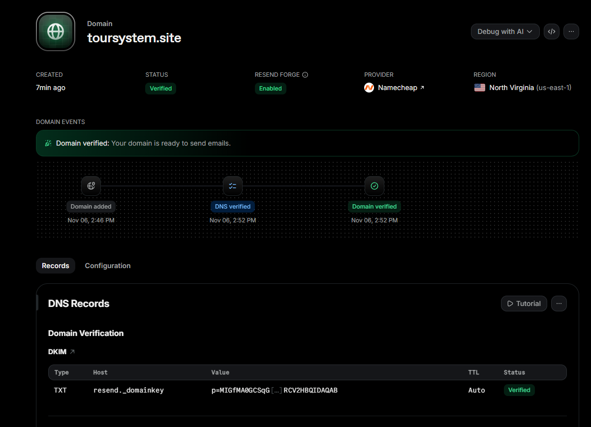
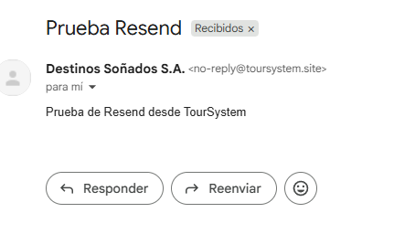
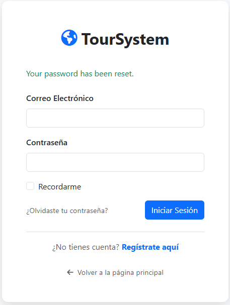
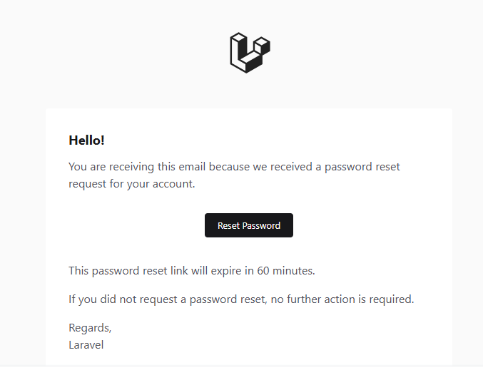

---
📊 Better Stack — Monitoreo y Disponibilidad
Plataforma: https://betterstack.com/

Better Stack supervisa la disponibilidad (Uptime) de la aplicación desplegada en Railway.

Configuración:

Monitor de tipo HTTP(s) apuntando a https://www.toursystem.site

Intervalo de chequeo: 3 minutos

Alertas configuradas por correo electrónico ante caídas

Región de chequeo: múltiples regiones

Verificaciones realizadas:

✅ Monitor de Uptime activo

✅ Supervisión de la URL pública

✅ Alertas configuradas ante interrupciones

✅ Información de disponibilidad e incidentes visible en el panel

Evidencias:

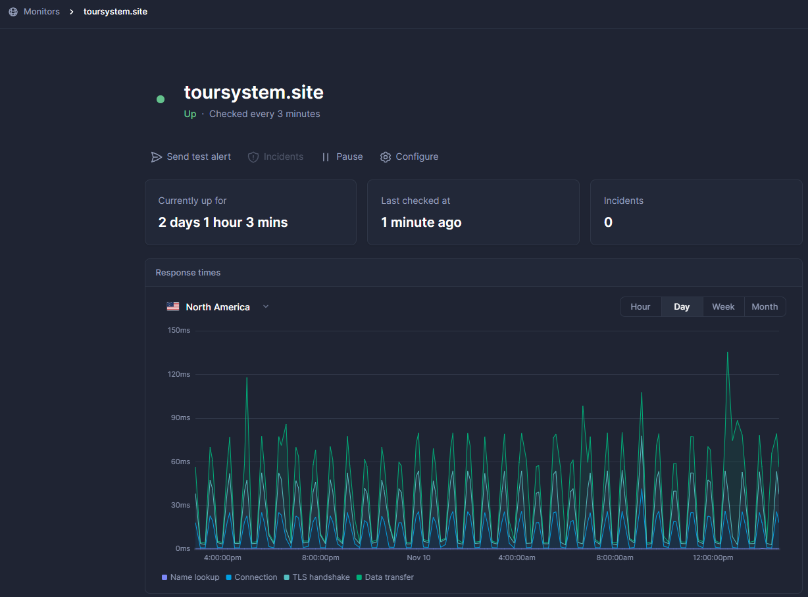
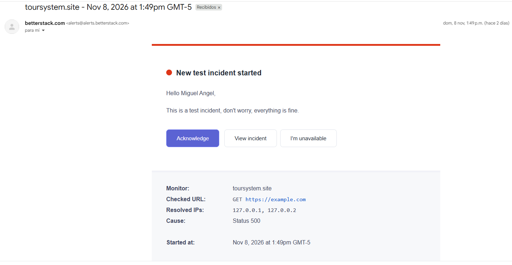

---
🗄️ Backblaze B2 — Almacenamiento Externo
Plataforma: https://www.backblaze.com/

Backblaze B2 se usa como almacenamiento externo compatible con S3 para archivos de la aplicación.

Configuración:
FILESYSTEM_DISK=s3
AWS_ACCESS_KEY_ID=xxxxxxxxxxxxxxxxx
AWS_SECRET_ACCESS_KEY=xxxxxxxxxxxxxxxxxxxxxxxxxxxxx
AWS_DEFAULT_REGION=us-east-005
AWS_BUCKET=toursystem-archivos
AWS_ENDPOINT=https://s3.us-east-005.backblazeb2.com
AWS_USE_PATH_STYLE_ENDPOINT=true
AWS_REQUEST_CHECKSUM_CALCULATION=when_required
AWS_RESPONSE_CHECKSUM_VALIDATION=when_required

Verificaciones realizadas:

✅ Bucket toursystem-archivos creado y configurado

✅ Credenciales de acceso (Application Keys) configuradas

✅ Integración con el filesystem de Laravel (Storage::disk('s3'))

✅ Carga y recuperación de archivos exitosa

✅ Archivos almacenados en B2 y no en disco local del servidor

### 🗄️ Backblaze B2 — Almacenamiento Externo

Evidencias:

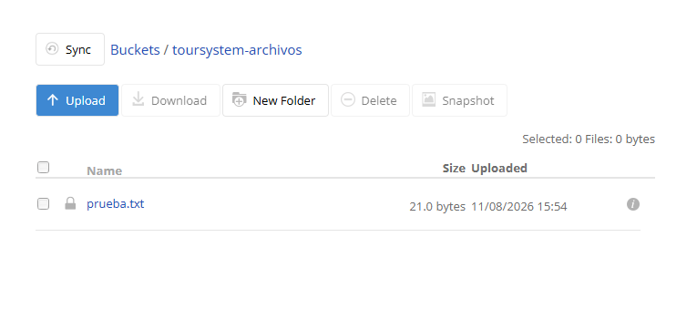
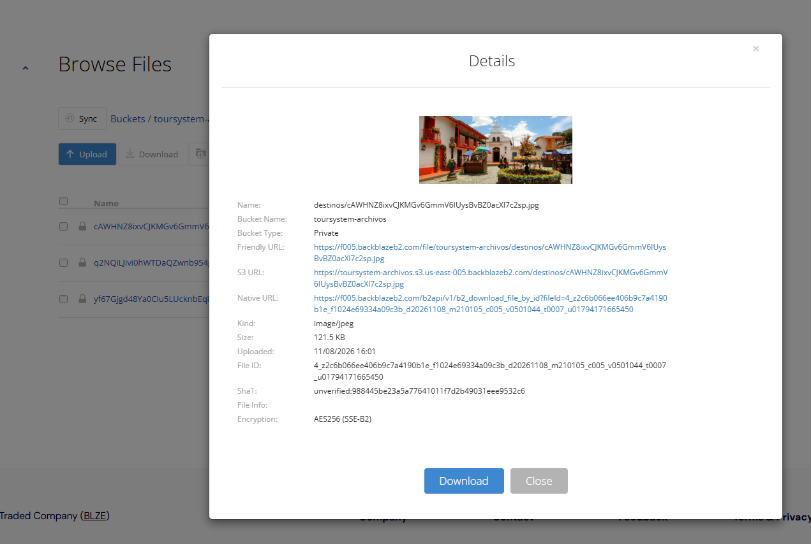
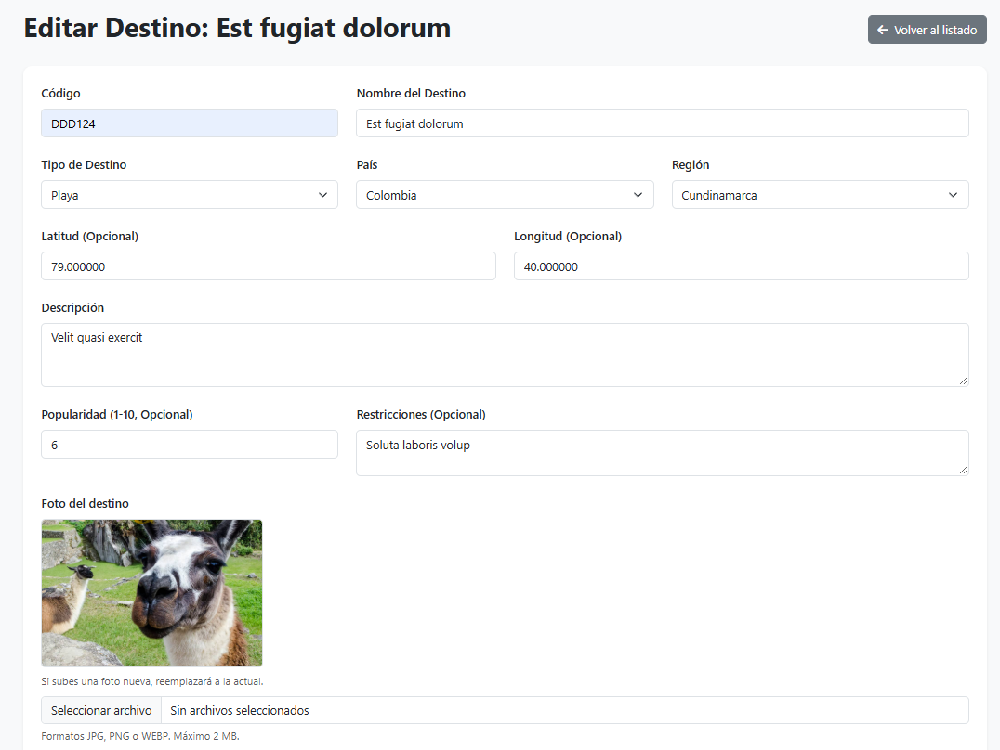
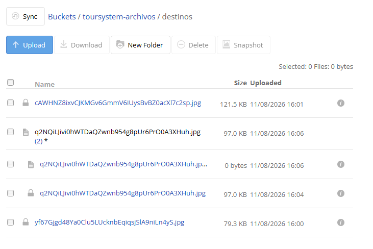
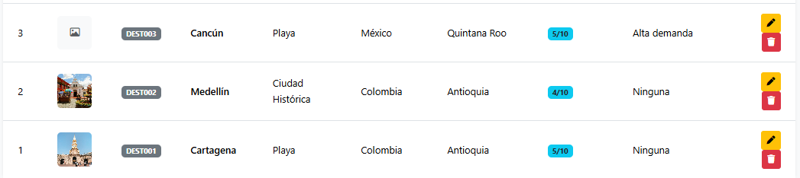

---
🐛 Sentry — Seguimiento de Errores
Plataforma: https://sentry.io/
Librería: sentry-laravel

Sentry identifica, registra y analiza errores en tiempo de ejecución.

Instalación:
composer require sentry/sentry-laravel
php artisan sentry:publish --dsn=TU_DSN

Configuración en las variables de entorno:
SENTRY_LARAVEL_DSN=https://xxxxxxxxxxxxx@o000000.ingest.us.sentry.io/0000000

Verificaciones realizadas:

✅ Proyecto creado y configurado en Sentry

✅ Integración con Laravel mediante el SDK oficial

✅ Variables de entorno configuradas

✅ Evento de prueba generado correctamente

✅ Errores visibles desde el panel de Sentry
### 🐛 Sentry — Seguimiento de Errores

Evidencias:

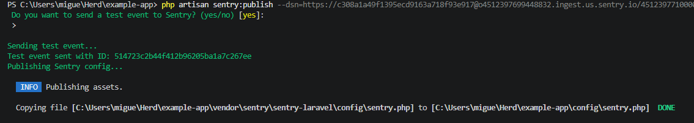
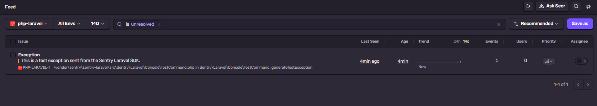
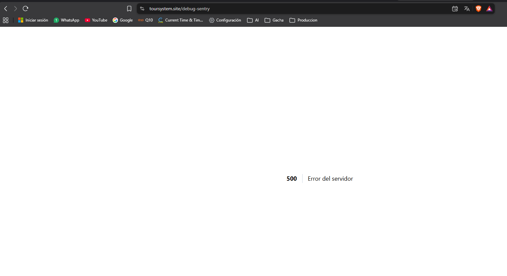
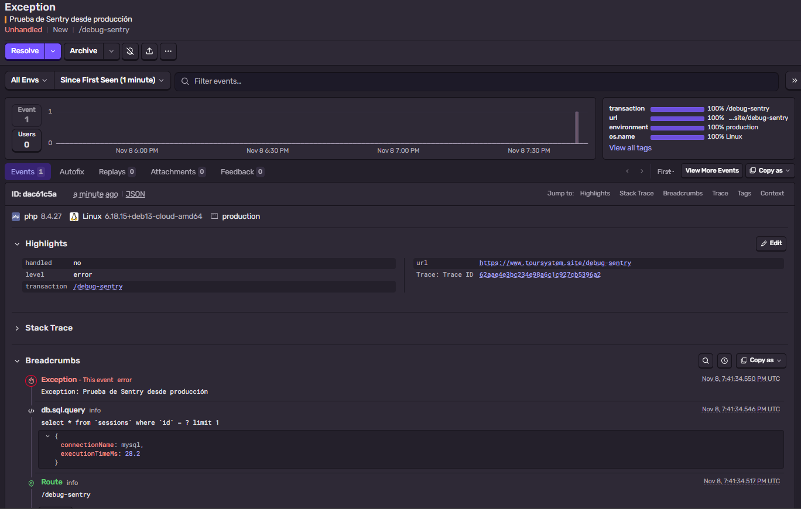
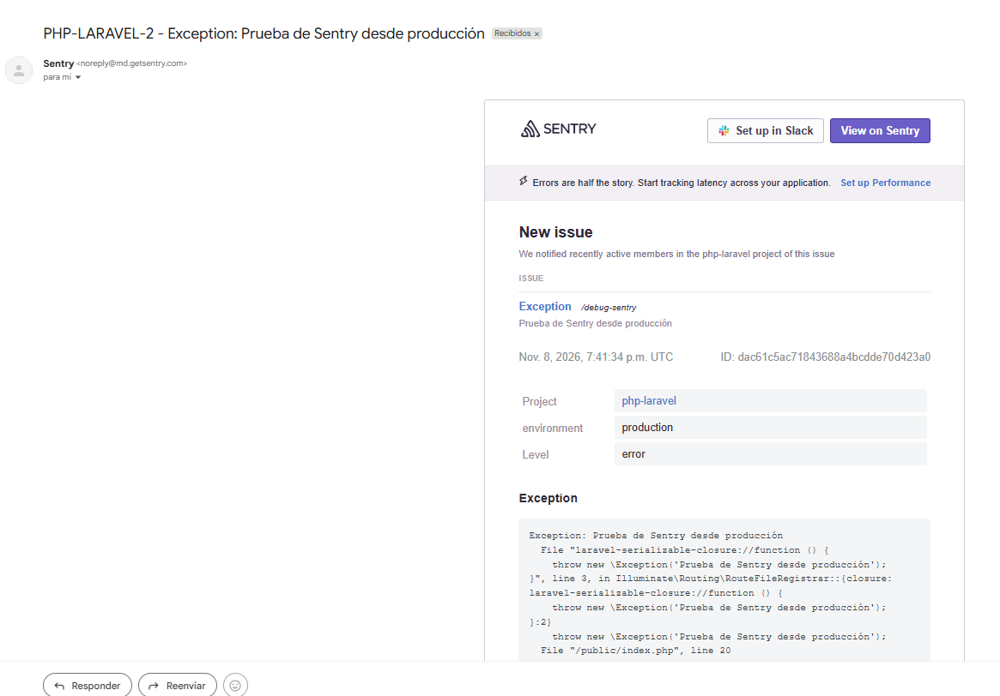

---
🔒 Privacidad y Tratamiento de Datos Personales
Conforme a la Ley 1581 de 2012 (Colombia) y sus disposiciones reglamentarias, la aplicación incorpora:

Política de tratamiento de datos
📄 Política de privacidad accesible públicamente desde el footer de la Landing

📄 Información clara sobre la finalidad del tratamiento

📄 Identificación del responsable del tratamiento y canales de contacto

Autorización del titular
✅ Checkbox de aceptación obligatorio en el registro

✅ Registro del consentimiento (fecha y versión de la política) en la tabla users

✅ Finalidades del tratamiento informadas al usuario

Derechos del titular
✅ Canal de contacto para ejercer derechos (acceso, corrección, supresión, revocación)

✅ Medidas de protección: contraseñas hasheadas (bcrypt), HTTPS, roles y middleware de autorización

### 🔒 Privacidad y Tratamiento de Datos

Evidencias:

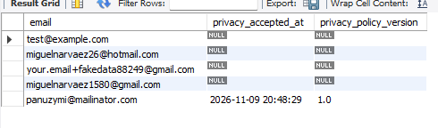
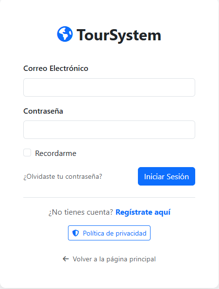
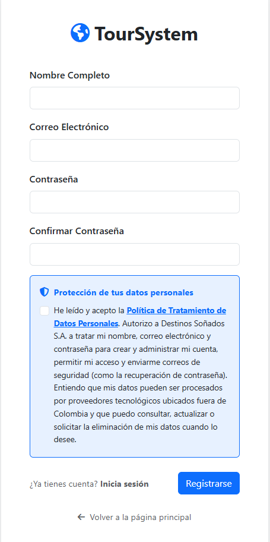
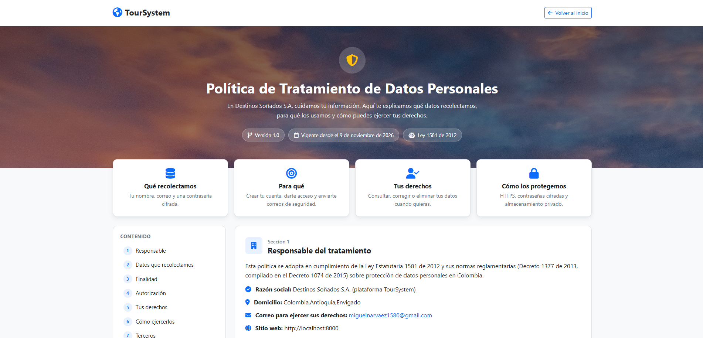

---
🗑️ Eliminación de Cuenta
La aplicación permite a cualquier usuario solicitar la eliminación de su cuenta de forma visible y accesible.

Flujo implementado
Acceso: el usuario va a Perfil → Eliminar cuenta.

Confirmación: debe ingresar su contraseña para evitar eliminaciones accidentales.

Proceso: se ejecuta la eliminación de la cuenta y de los datos personales asociados (o anonimización según el caso).

Registros relacionados: las reservas asociadas se eliminan o anonimizan según las obligaciones legales de conservación.

Información: se advierte al usuario sobre las consecuencias de la eliminación.

Protección: la operación requiere autenticación previa (password + sesión activa).

ℹ️ Los datos que deban conservarse por mandato legal (ej. registros contables de reservas) no se eliminan indiscriminadamente; se anonimizan para preservar la integridad de los registros históricos.

### 🗑️ Eliminación de Cuenta

Evidencias:

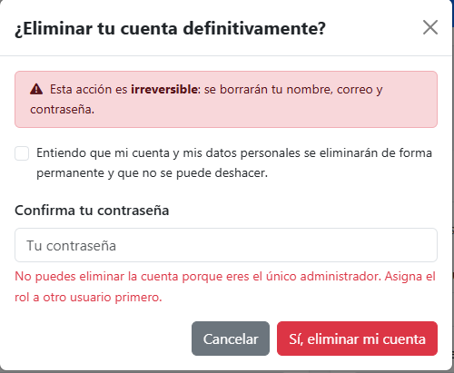
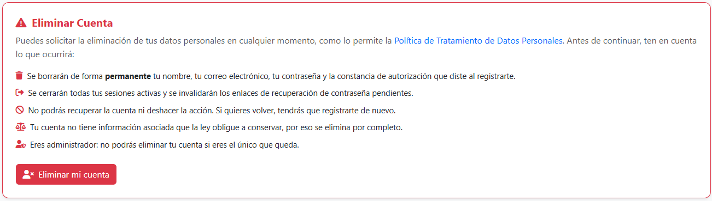